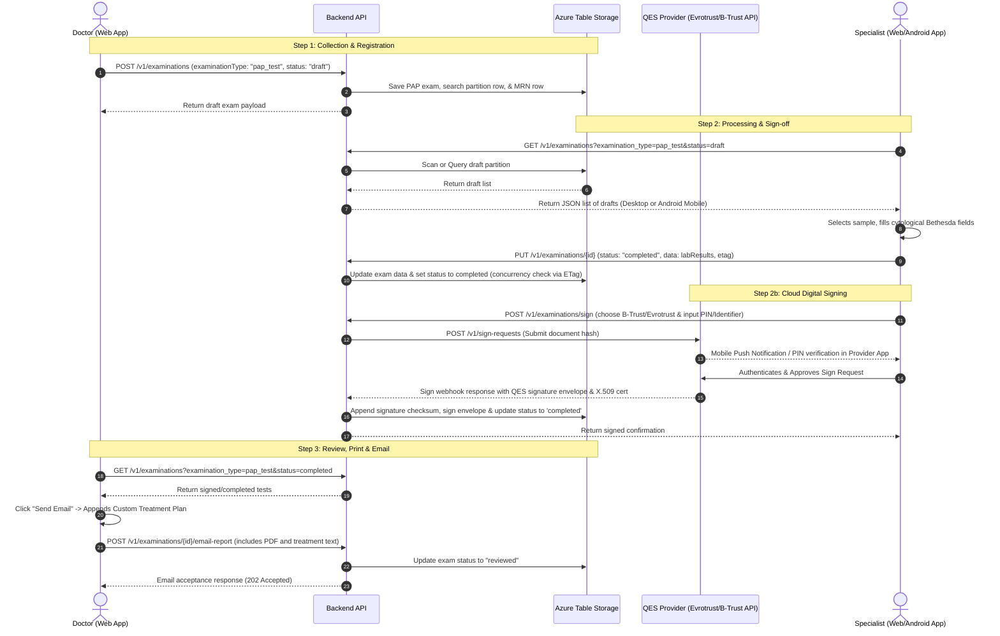

# PAP Test Feature Support - User Stories & Epic Breakdown

This document compiles the user stories, sequence & lifecycle diagrams, and technical requirements needed to implement support for the new **PAP Test** examination type.

The PAP Test workflow features a multi-device, multi-platform architecture:
1. **Doctors** register the initial patient material collection in a web portal.
2. **Lab Specialists** process and sign off on cytological results using **either** a responsive desktop web interface **or** a dedicated, focused **Android Mobile App**.
3. **Lab Specialists** digitally sign finalized examinations using officially supported Qualified Electronic Signature (QES) cloud services (**B-Trust** or **Evrotrust**).
4. **Doctors** review, print, and email finalized reports containing specialized treatment plans back on the web portal.

---

## 1. Sequence & Data Lifecycle Diagram

---

## 2. Functional User Stories

### Story 1: Create Draft PAP Test and Fill Initial Information (Step 1)
**Title**: Create Draft PAP Test and Fill Initial Information

**As a** Doctor,  
**I need to** select "PAP Test" as an examination type, associate it with a patient, input initial collection parameters, and save it,  
**So that** a new examination record is successfully registered in the database in a `draft` status, ready for laboratory routing.

**Acceptance Criteria**:
1. The user can select `pap_test` from the "Examination Type" dropdown in `frontend/src/components/ExaminationForm.tsx`.
2. Selecting `pap_test` dynamically updates the clinical sections shown (hiding prenatal ultrasound forms like biometry and doppler per `SECTION_VISIBILITY` rules) and displays the initial PAP collection fields:
   * **Sample ID / Barcode** (required, unique string)
   * **Material Source** (e.g., Cervical, Vaginal, Endocervical)
   * **Collection Date** (date picker, defaults to current date)
   * **Clinical Diagnosis & Symptoms** (textarea)
   * **Notes** (textarea)
3. Submitting the form triggers a `POST` request to `api/src/functions/CreateExamination.ts` with `examinationType: 'pap_test'` and `status: 'draft'`.
4. The system validates that the **Sample ID / Barcode** is unique across active examinations. If duplicate, it returns a validation error preventing submission.
5. Saving the draft correctly writes the dual records (the main `PATIENT_{id}` row and the `MRN/{mrn}` lookup row) into Azure Table Storage as defined in `api/src/types/index.ts`.

**Edge Cases & Considerations**:
* **Duplicate Material Check**: Simultaneous creation of the same Sample ID must be mitigated on the backend with concurrent checks or a unique index constraint.
* **Missing Patient Details**: If the patient lacks a populated birth date, the app must still allow draft creation but flag a warning, since cytological interpretation depends heavily on patient age.

---

### Story 2: Lab Specialist Login and Draft Tests List (Web & Mobile)
**Title**: Authenticate Specialist and Display Draft PAP Tests List

**As a** Lab Specialist,
**I need to** securely log in to either the Desktop Web App or the dedicated Android Mobile App and view a list of pending PAP Tests in draft status,
**So that** I can easily identify which patient samples are ready for laboratory analysis regardless of my active device.

**Acceptance Criteria**:
1. The specialist login screen enforces a TLS 1.2+ connection using a username and password. The credential verification is integrated with the central `api/src/functions/Login.ts` endpoint.
2. The user profile is validated on the server side: only users with `role: 'specialist'` (or `'lab_specialist'`) are allowed access. Other roles are rejected with a `403 Forbidden` error.
3. Upon authentication, both platforms display a list of PAP tests in `draft` status, fetched via `GET /v1/examinations?examinationType=pap_test&status=draft` from the backend.
4. The list displays the following information:
   * **Sample ID / Barcode**
   * **Patient Name** (retrieved from denormalized `patientName`)
   * **Collection Date**
   * **Material Source**
5. Tapping/clicking a search/filter bar allows the specialist to scan a barcode (mobile camera / scanner) or type a Sample ID to immediately find a specific draft.
6. The list uses server-side pagination with the Azure continuation token model, loading subsequent entries via a "Load More" action or infinite scroll.

**Edge Cases & Considerations**:
* **Session Expiry**: If the JWT signature expires or is revoked, the app/web page must immediately clear session details, terminate the session, and redirect to the login screen.
* **Offline Access (Mobile)**: On mobile boot, if no internet connection is detected, the Android app displays a clear offline indicator and loads the last-cached list from the local encrypted SQLite database.

---

### Story 3: Cytological Lab Form Processing (Web & Mobile)
**Title**: Cytological Evaluation and PAP Test Processing

**As a** Lab Specialist,
**I need to** open a draft PAP Test on the Desktop Web App or Android phone, view its collection details, and input cytological findings,
**So that** the lab analysis is recorded on the test record.

**Acceptance Criteria**:
1. Opening a draft test displays a focused, structured view. The header displays read-only collection metadata: Patient Name, Age, Sample ID, Collection Date, and Material Source.
2. The specialist is presented with the clinical cytological fields (which utilize responsive layout spacing based on screen width):
   * **Specimen Adequacy**: Dropdown (e.g., *Satisfactory for evaluation*, *Unsatisfactory for evaluation*)
   * **General Categorization**: Dropdown (e.g., *Negative for Intraepithelial Lesion*, *Epithelial Cell Abnormalities*)
   * **Interpretation / Result**: Standardized Bethesda taxonomy dropdowns (e.g., *NILM, ASC-US, LSIL, HSIL, Squamous Cell Carcinoma*)
   * **Recommendation / Comments**: Textarea
   * **Microscopic Description**: Textarea
3. Clicking "Submit/Update" calls `PUT /v1/examinations/{id}` with the clinical payload stored inside `data` in the database.
4. The update request must include the `etag` read from the initial GET to ensure optimistic concurrency, preventing overwrites of results processed simultaneously on other devices.
5. Successful submission changes the test state to `completed` but *unsigned* (a signature is required before it is available to the doctor).

**Edge Cases & Considerations**:
* **Unsatisfactory Specimens**: If "Specimen Adequacy" is set to *Unsatisfactory*, the system allows submission with fewer interpretation details, dynamically relaxing validation requirements on Bethesda sub-fields.
* **Cross-Device Edits**: If a specialist starts editing on the mobile phone but switches to the computer (or vice versa), the system uses the standard ETag optimistic concurrency check to surface 412 conflicts if changes were made in-between.

---

### Story 4: Specialist Qualified Electronic Signing via B-Trust & Evrotrust Cloud (Web & Mobile)
**Title**: Cloud QES Signing (Individual & Bulk) via B-Trust and Evrotrust

**As a** Lab Specialist,
**I need to** digitally sign completed PAP tests using an official qualified cloud electronic signature (QES) via B-Trust or Evrotrust,
**So that** the results are finalized, legally verified, and released back to the requesting doctor.

**Acceptance Criteria**:
1. On the test detail screen (or main list "Bulk Actions"), a "QES Cloud Sign" button is available for completed but unsigned tests.
2. The user is prompted to select their QES Cloud Provider: **B-Trust** or **Evrotrust**.
3. Upon selecting the provider, the specialist provides their unique cloud identifier (e.g., personal identification number/egn, phone number, or cloud ID).
4. The web/mobile client initiates a signing session via `POST /v1/examinations/{id}/sign-session` (or `POST /v1/examinations/bulk-sign-session` for multiple selected tests), submitting the provider selection and user identifier.
5. The backend generates a secure PDF report layout for each examination, computes its SHA-256 hash, and calls the selected QES provider's REST API to initiate a cloud signing request.
6. The specialist receives a push notification on their official QES smartphone application (Evrotrust or B-Trust Mobile App) and completes biometric/PIN validation to approve the signing request.
7. The backend receives a webhook notification (or polls the provider endpoint) upon approval, containing the Qualified Electronic Signature envelope and X.509 signing certificate.
8. The backend verifies the signature envelope against the original document hash, writes the signature details to Table Storage, and updates the exam status to `completed` (signed).
9. Once signed, the test becomes immutable; no further edits are permitted by any specialist.

**Edge Cases & Considerations**:
* **Signature Timeout/Declined**: If the specialist declines the push request or the request times out (e.g., after 120 seconds), the backend cancels the session, unlocks the exam, and the client displays a clear cancellation message.
* **Bulk Provider Limitations**: When signing in bulk, if the chosen cloud QES provider does not support multi-document signing in a single push, the backend must group the sign requests into sequential pushes or clearly guide the user through the provider-defined bulk approval sequence.

---

### Story 5: Doctor Review, Print, and Email Delivery with Treatment Definition (Step 3)
**Title**: Review, Print, and Email Finalized PAP Tests with Treatment Plan

**As a** Doctor,  
**I need to** view signed PAP Tests on the web portal, print the report, or email it directly to the patient along with a customized treatment plan,  
**So that** the patient is informed of their clinical status and receives their therapeutic path.

**Acceptance Criteria**:
1. The Doctor can filter the Examinations list on the web portal by selecting `examination_type: 'pap_test'` and `status: 'completed'` (signed).
2. Opening a finalized PAP test displays a clean, professional medical report card featuring patient demographics, collection context, the cytological Bethesda results, and the signing Specialist's name and signature timestamp.
3. Clicking "Print Report" renders a print-optimized document (using custom `@media print` rules) formatting the entire report onto a single sheet of paper, hiding navigation headers, footers, and interactive action buttons.
4. Clicking "Email Report" opens a modal containing:
   * **Recipient Email**: Read-only patient email retrieved from `api/src/types/index.ts`, with an edit toggle if an override is needed.
   * **Subject**: Pre-populated template (e.g., "Laboratory Results - PAP Test").
   * **Treatment / Recommendations**: A free-text box allowing the Doctor to write therapeutic notes.
5. Submitting the modal triggers a `POST` request to `/v1/examinations/{id}/email-report`.
6. The backend compiles the report details and includes the Doctor's customized "Treatment" note both inside the email body and appended to the final section of the attached PDF report.
7. Upon successful delivery (202 Accepted status from the mail sender), the examination's status changes to `reviewed`.

**Edge Cases & Considerations**:
* **No Email in Profile**: If the patient's record lacks an email address, the modal displays a warning and forces the Doctor to type in a recipient email address manually.
* **Sensitive Information Protection**: The PDF attachment must be encrypted or password-protected using the patient's birth date as a password fallback to ensure compliance with health information privacy regulations.

---

## 3. Technical & Architecture Stories

### Story 6: Schema and Registry Updates for PAP Test (Epic Decomposition)
**Title**: Update central Registry, Schemas, and DB Models for PAP Test Support

**As a** Developer,  
**I need to** register `pap_test` in the central exam type configuration, define its payload structures, and update Joi validations,  
**So that** the system can process and store PAP-specific records.

**Acceptance Criteria**:
1. Register key `"pap_test"` in the canonical `examinationTypes.ts` constants file and add its corresponding `SECTION_VISIBILITY` map.
2. Extend `Examination` and `ExaminationData` interfaces in `api/src/types/index.ts`:
   * Support `'pap_test'` value in `examinationType`.
   * Add `PapTestData` clinical interface carrying `sampleId`, `materialSource`, `specimenAdequacy`, `generalCategorization`, `bethesdaInterpretation`, and `signatureData` fields.
   * Add `specialist` to the valid `User.role` enum.
3. Update the backend validation in `api/src/utils/validation.ts`:
   * Add Joi rules validating that `sampleId` is between 3 and 50 characters, and matches specific barcode alphanumeric formats.
   * Enforce required fields validation based on the `examinationType` context during creation and updates.
4. Adapt search and filtering queries in `api/src/functions/GetExaminations.ts` to handle `examination_type` and `status` correctly via OData clauses.

---

### Story 7: Specialist Secure API Gateway and Cloud QES Integrations
**Title**: Specialist Web/Mobile API Endpoints & Cloud QES Integrations

**As a** Backend Engineer,
**I need to** establish dedicated, authenticated API endpoints to support both desktop and mobile specialist tasks, including integration wrappers for B-Trust and Evrotrust,
**So that** Specialists can process forms securely and invoke legal Qualified Electronic Signatures (QES).

**Acceptance Criteria**:
1. Implement responsive API endpoints to list drafts: `GET /v1/specialist/examinations?status=draft` which supports filters (Sample ID, Date range) and server-side continuation-token pagination.
2. Build signature session endpoints: `POST /v1/specialist/examinations/{id}/sign-session` (and bulk counterpart) that accepts provider type (`evrotrust` or `btrust`) and the specialist's identifier.
3. Integrate REST client wrapper classes that translate signing requests into B-Trust and Evrotrust partner APIs:
   * Map input data to PDF templates.
   * Generate sha256 document hash.
   * Format API payloads according to the specific provider's specification.
4. Build webhooks endpoints: `/v1/webhooks/sign/evrotrust` and `/v1/webhooks/sign/btrust` to handle asynchronous signing approval events, parsing the signature envelope and digital certificates from provider payloads.
5. All specialist endpoints enforce strict role verification, allowing access exclusively to authenticated users carrying the `specialist` (or `lab_specialist`) role.

---

## 4. Non-Functional & Security Stories

### Story 8: Mobile Synchronization and Data Integrity
**Title**: Android App Offline Capabilities and Local SQLite Integrity

**As a** Lab Specialist,
**I need the** mobile app to securely store my evaluations locally when the internet goes offline and synchronize them automatically once connection is restored,
**So that** my diagnostic progress is never lost due to wireless drops.

**Acceptance Criteria**:
1. The Android application implements a local cache using an encrypted database (e.g., Room with SQLCipher or native device-level encryption).
2. When the device transitions from online to offline, the application allows the Specialist to continue filling out forms, storing pending updates locally.
3. A background service monitors network connectivity using standard Android connection broadcasts.
4. When online status is restored, the application syncs local updates sequentially.
5. If an `etag` mismatch occurs during sync, the app halts sync for that specific record, prompts a conflict resolution UI to the specialist, and moves on to sync the next record.
6. The app utilizes Android's WorkManager framework to guarantee sync completion even if the app is closed or backgrounded.

---

### Story 9: Qualified Signature Verification, Trust, and non-Repudiation
**Title**: Qualified Signature Verification and Cryptographic Integrity

**As a** Clinical Security Officer,
**I need to** cryptographically verify the X.509 signature envelope returned by B-Trust or Evrotrust,
**So that** the signed medical results are verified for trust and guaranteed to be tamper-proof and legally non-repudiative.

**Acceptance Criteria**:
1. The backend implements validation routines for incoming signature envelopes:
   * Parse and verify the X.509 signing certificate's validity and trust chain (against the provider's Root and Intermediate CAs).
   * Confirm the signing certificate belongs to the active, authorized Lab Specialist user.
   * Extract and store the signature envelope (CAdES / PAdES standard format) alongside the exam record.
2. A unique SHA-256 integrity hash (`signatureChecksum`) is computed combining the finalized cytological findings, the signature envelope, and a server-side pepper key, then stored on the `Examination` record.
3. Whenever a PAP test is loaded on the portal for printing, viewing, or emailing, the portal recalculates the SHA-256 integrity hash of the active clinical data and compares it to `signatureChecksum`.
4. If there is any mismatch (indicating manual DB editing or data corruption), the app displays a prominent alert: "WARNING: Result integrity compromise detected!" and disables the "Email Report" action.
5. The digital signing process complies with the EU eIDAS regulation (EU No 910/2014) for Qualified Electronic Signatures (QES), ensuring absolute legal weight and non-repudiation in healthcare records.
