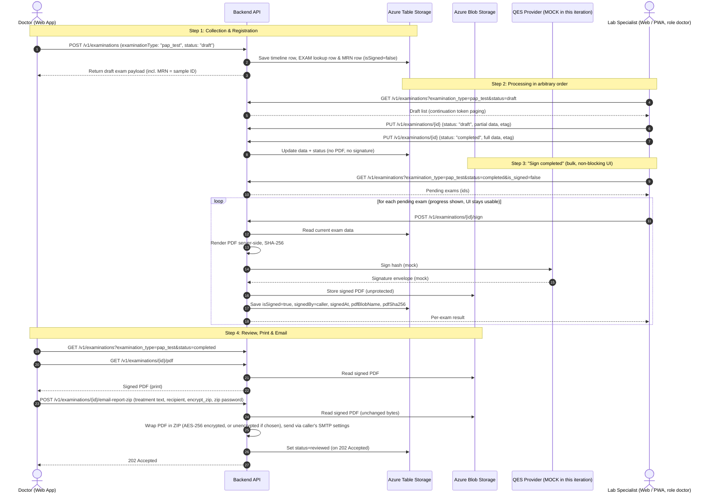

# PAP Test Feature Support - User Stories & Epic Breakdown

This document compiles the user stories, lifecycle diagrams, and technical requirements needed to implement support for the new **PAP Test** examination type.

**Source of clarifications:** [`PAP-TEST-ImplementationGuideLines.txt`](PAP-TEST-ImplementationGuideLines.txt) and subsequent product-owner decisions. Where this document and those decisions disagree, the decisions win.

## 0. Scope, Principles & Decisions

1. **PAP Test is just another examination type** (`pap_test`). It follows all existing conventions: routes under `v1/examinations`, the three-row Examinations storage pattern (timeline `PATIENT_{patientId}`, lookup `EXAM/{examinationId}`, `MRN/{mrn}`), soft delete, ETag in the request body, `successResponse()`/`errorResponse()` envelopes, and the existing `requireAuth` / `requireRole(['doctor','admin'])` guards.
2. **No new role.** "Doctor" (collection, review, email) and "Lab Specialist" (cytology, signing) are *personas*. In the application both are users with role `doctor`. Admins keep their existing access.
3. **No separate Sample ID.** The **MRN** is the sample identifier. MRN uniqueness is already guaranteed by the existing MRN generator. Specialists find a draft by browsing the draft list or by **patient name search** (Story 2); there is no barcode scanning.
4. **Collection date = `examDate`**. `birthDate` is mandatory on `Patient`, so patient age is always available. `gestationalAge` is **not required** for `pap_test`.
5. **Lifecycle uses the existing statuses; completing and signing are two separate steps:**
   * `draft` – created by the doctor; the specialist works on drafts **in arbitrary order** and may save intermediate progress at any time.
   * `completed` – the specialist marks the test complete when his cytology work on it is done. **This does not sign it and creates no PDF.**
   * **Signed** – at any time the specialist clicks **"Sign completed"**, which runs a **bulk sign** over all completed-but-unsigned PAP tests: for each, the PDF is rendered, signed by the **user who clicked the button**, and stored. *Signed* is **not a status**; it is tracked by a server-set flag (`isSigned`, see Section 2) so the status set stays `draft | completed | reviewed`.
   * `reviewed` – set manually by a doctor, **or** automatically when an email is accepted by the mail sender (`202 Accepted`).
6. **The signer takes responsibility for what he signs.** The signer is whoever triggers the signing (bulk sign or individual recreate), not necessarily the person who completed the test.
7. **Accepted risk (deferred to the next iteration):** a PAP test can be modified between being set to `completed` and the PDF being created. The PDF always reflects the Table data at signing time. Likewise, **read-only locking of completed tests is not implemented for any examination type today**; it will be introduced for **all** exam types at a later stage. Therefore completed and even signed PAP tests remain editable for now, and a later edit does not update an already stored PDF.
8. **QES is mocked in this iteration.** All signing steps run against a mock QES provider behind the final provider interface. Real B-Trust / Evrotrust integration, PIN/OTP handling and certificate validation are the **next iteration** (see Story 14).
9. **Signing must never block the UI.** Signing is performed as a background-style bulk operation with visible progress; the user can keep working.
10. **PWA instead of native mobile apps.** Mobile support is delivered as a Progressive Web App on the existing frontend.
11. **No amendments or corrections.** If a sample is unsatisfactory or rejected, the specialist notes it in the general `notes` field and completes the test; the patient is re-examined with a new PAP test.
12. **No notifications, no patient-consent step, no data-minimization changes** are in scope.

### Persona workflow

1. **Doctor** registers the sample collection in the web portal (`draft`).
2. **Lab Specialist** (role `doctor`) works through the list of drafts in any order on the web portal or PWA, saves progress, and sets each finished test to `completed`.
3. **Lab Specialist** clicks **"Sign completed"** whenever he wants; all completed, unsigned tests are signed and their PDFs created and stored.
4. **Doctor** reviews, prints, and emails the signed PDF (treatment plan in the email body; the signed PDF is sent inside a **ZIP**, by default **AES-256 password-protected** with the patient's birth date as the default password, or optionally an **unencrypted ZIP**). The test moves to `reviewed`.

---

## 1. Sequence & Data Lifecycle Diagram

---

## 2. Hybrid Storage Architecture & Data Flow

1. **Azure Table Storage (living source of truth)**: stores the cytological Bethesda data as the standard JSON `data` structure, like prenatal exams. It drives search, filters, list views and edit/detail views, and it is the source for creating and **recreating** the PDF.
2. **Azure Blob Storage (archive & legal seal)**: stores the signed PDF **without password protection**. For **printing and emailing** the stored signed PDF is used. For email, the **unchanged signed PDF is placed inside a ZIP** created at send time (AES-256 password-protected by default, unencrypted if the doctor chooses); the PDF bytes (and therefore the signature) are never modified, and the ZIP is never stored.
3. **Retention**: signed PDFs are kept for a **system-wide configurable retention period (default 90 days)**. Expiry is enforced by an **Azure Storage lifecycle rule** that deletes the blob; it does **not** update the Table record, and **no expiry date is stored** on the record: blob existence is the only authority. The application therefore treats a missing blob as a normal state: it answers HTTP 410, **dereferences** the blob from the Table record when it notices it (`pdfBlobName`/`pdfSha256` cleared, `isSigned` and signer fields kept), and offers "Recreate PDF" (Stories 7, 12).
4. **Deletion**:
   * Deleting an **examination** is a soft delete of its records, but its **PDF blob is permanently deleted**.
   * Deleting a **patient** permanently deletes all of that patient's PDF blobs; other linked objects are soft-deleted. Purging soft-deleted records is future work.
   * **Orphan blobs** (blobs with no referencing exam record, e.g., after a failed write) are deleted as soon as they are identified; the automatic backstop is a lifecycle rule on blobs tagged `state=pending` (short grace period). Referenced blobs are tagged `committed` and are removed by the retention rule.
5. **Signature/PDF metadata is stored on the `Examination` record, outside `data`.**

New server-controlled `Examination` fields: `isSigned` (boolean, false on creation for `pap_test`, enables the OData filter for bulk signing), `signedBy` (userId), `signedByName`, `signedAt`, `signatureProvider` (e.g. `mock`), `signatureEnvelope` (or reference), `pdfBlobName`, `pdfSha256`.

Derived UI states of a `pap_test`:

| Status | `isSigned` | PDF blob present | Meaning in UI |
|---|---|---|---|
| `draft` | false | no | Draft – being worked on |
| `completed` | false | no | Completed – awaiting signature |
| `completed` / `reviewed` | true | yes | Signed – print/email available |
| `completed` / `reviewed` | true | no (deleted by lifecycle rule, or dereferenced after detection) | Signed, PDF no longer available – "Recreate PDF" available |

---

## 3. Functional User Stories

### Story 1: Create Draft PAP Test (Doctor)
**Title**: Create Draft PAP Test and Fill Collection Information

**As a** Doctor,
**I need to** select "PAP Test" as an examination type for a patient, enter the collection information and save it,
**So that** a new examination is registered in `draft` status with an MRN that identifies the physical sample.

**Acceptance Criteria**:
1. `pap_test` is selectable in the "Examination Type" dropdown of [`ExaminationForm.tsx`](../frontend/src/components/ExaminationForm.tsx).
2. Selecting `pap_test` shows only the PAP sections defined by its `SECTION_VISIBILITY` entry (prenatal biometry/doppler sections are hidden) with these collection fields:
   * **Material Source** (e.g., Cervical, Vaginal, Endocervical)
   * **Collection Date** – the existing `examDate` field (defaults to today)
   * **Clinical Diagnosis & Symptoms** (textarea)
   * **Notes** (textarea, existing `notes`)
3. `gestationalAge` is **not required** for `pap_test`; no gestational-age validation or calculation is applied.
4. There is **no Sample ID input**. The MRN generated by the existing [`mrnGenerator.ts`](../api/src/utils/mrnGenerator.ts) is the sample identifier and is shown prominently after save.
5. Submitting calls the existing `POST /v1/examinations` with `examinationType: 'pap_test'` and `status: 'draft'`. The existing three-row storage applies unchanged. The server sets `isSigned = false`.
6. The patient's age at collection is derived from the mandatory `birthDate` and stored as `patientAgeAtExam`.
7. After saving, the doctor can still **edit and delete** the draft (also after lab work has started), using the existing ETag-in-body concurrency pattern.

**Edge Cases & Considerations**:
* Concurrent edit of the same draft by doctor and specialist → existing optimistic-concurrency conflict (`isConcurrencyConflict`) is shown with a reload prompt.
* Material Source is a controlled list; invalid values are rejected server-side (allowlist).
* Text fields are length-limited and sanitised through existing validation conventions.

---

### Story 2: Draft PAP Tests List and Lookup (Lab Specialist, Web & PWA)
**Title**: Display Draft PAP Tests and Find a Sample by Patient Name

**As a** Lab Specialist (application role `doctor`),
**I need to** see the list of draft PAP tests with patient names and examDates on the web portal and on my phone (PWA) and pick any of them to work on, or find one by typing patient name,
**So that** I can process samples in arbitrary order.

**Acceptance Criteria**:
1. The list is the existing examinations list filtered by `examination_type=pap_test&status=draft` and by date range via `GET /v1/examinations`. No new role and no new list endpoint. The default date range is the last 7 days (`from_date`/`to_date`, user-adjustable). **No backend sort option is added**; the list is sorted **on the client by patient name** (AC3).
2. Each row shows: **MRN (sample ID)**, **Patient Name**, **Collection Date** (`examDate`), **Material Source**. The specialist may open any row; there is no enforced processing order, no claiming and no locking.
3. Because the client sorts by patient name, it must hold the **complete** result for the selected date range. The client follows the existing continuation token (page size 100) until no token is returned, showing a loading indicator, and only then displays the list sorted **by patient name** (case-insensitive, Bulgarian/Cyrillic-aware locale comparison; ties by `examDate`, then MRN). There is no "Load more" button on this list, so rows never jump between pages. Empty intermediate pages that still carry a continuation token are followed and do not produce a false "no results" state.
4. A search field accepts a typed patient name and resolves it through the existing patient name search. Search is triggered only by explicit submission (Enter / button), never on keystroke or debounce.
5. If name is unknown, deleted or not a PAP test, a clear message is shown instead of opening a wrong record.
6. The list screen also hosts the **"Sign completed"** control with the pending count (Story 5).
7. **Older-drafts hint**: after the list has loaded, the client checks whether any draft PAP test exists **before the selected range** (`examination_type=pap_test&status=draft`, `to_date` = the day before `from_date`, `from_date` = 90 days before the range start, `pageSize=1`). If one exists, a non-blocking banner shows "Older draft PAP tests exist before {from_date}" with an **"Extend range"** action that sets the range start to the 90-day look-back limit and reloads. If none exists, nothing is shown. The check uses existing query parameters only (no new endpoint) and runs once per range change or refresh, never on keystroke.

**Edge Cases & Considerations**:
* **Safety cap**: if the range returns more than 1,000 rows, loading stops and the screen shows "Too many results – narrow the date range", so a mistaken wide range cannot hang the phone. The sort is by patient name only for the loaded set; the cap prevents a partial set being presented as complete.
* A failed page request during loading shows an error with a retry; a partially loaded list is not shown as if complete.
* The list is a snapshot for the selected range; a test created by someone else after loading appears on the next refresh or range change (a manual "Refresh" action is provided).
* **Hint look-back is bounded (90 days)** so the check stays cheap; Table Storage filters scan the partition and may return empty pages with a continuation token, so the check follows tokens until it finds one row, reaches the end, or hits a cap of 10 pages, whichever comes first. Drafts older than the look-back are not announced; they remain reachable through the patient name search or by manually widening the range.
* If the hint check fails (network or server error), it is silently skipped; it never blocks or delays showing the main list.
* Boundary dates use the same date format as the stored `examDate`, so a test dated exactly on `from_date` is in the list, not in the hint.
* After "Extend range", the 1,000-row safety cap still applies.
* Session expiry → existing 401 handling clears the session and redirects to login.
* Users with role `viewer` follow existing authorisation behaviour.

---

### Story 3: Cytological Evaluation and Intermediate Save (Lab Specialist, Web & PWA)
**Title**: Enter Cytological Findings and Save Progress

**As a** Lab Specialist,
**I need to** open a draft PAP test, review the collection data and enter cytological findings, saving intermediate progress as often as needed,
**So that** I never lose work while analysing a sample.

**Acceptance Criteria**:
1. The detail view shows read-only collection data: Patient Name, Age, MRN, Collection Date, Material Source, Clinical Diagnosis & Symptoms.
2. Cytological fields (responsive layout, usable at phone width):
   * **Specimen Adequacy** – dropdown: *Satisfactory for evaluation*, *Unsatisfactory for evaluation*
   * **General Categorization** – dropdown: *Negative for Intraepithelial Lesion*, *Epithelial Cell Abnormalities*
   * **Interpretation / Result** – Bethesda dropdown: *NILM, ASC-US, LSIL, HSIL, Squamous Cell Carcinoma*
   * **Recommendation / Comments** – textarea
   * **Microscopic Description** – textarea
3. The option lists live in one central constants location so the Bethesda coverage can be extended in a later iteration. Only the values above are in scope now.
4. **Save** (intermediate) calls `PUT /v1/examinations/{id}` with `status: 'draft'`, the `etag` in the request body, and **partial data is allowed** (type/length checks only).
5. A stale `etag` yields the existing conflict response; the UI shows the conflict message and offers a reload (optimistic conflict only).
6. A **"Mark as completed"** action is available (Story 4).

**Edge Cases & Considerations**:
* **Unsatisfactory or rejected sample**: recorded as a comment in the general `notes` field; the test is then completed like any other. There is no rejected state and no amendment; the patient is re-examined with a new PAP test.
* Cross-device editing (web ↔ phone) relies on the same ETag conflict check.
* A draft deleted by a doctor meanwhile returns the existing not-found handling.

---

### Story 4: Mark PAP Test as Completed (Lab Specialist, Web & PWA)
**Title**: Set a PAP Test to "Completed" When Lab Work Is Done

**As a** Lab Specialist,
**I need to** put a PAP test in state `completed` as soon as I finish my work on it,
**So that** it is queued for the next bulk signing and I can continue with other samples.

**Acceptance Criteria**:
1. "Mark as completed" calls `PUT /v1/examinations/{id}` with `status: 'completed'`, the full `data` and `etag`. **No PDF is created and nothing is signed in this step.**
2. Server-side completion validation (`pap_test` only):
   * `specimenAdequacy` is required.
   * If *Satisfactory*: `generalCategorization` and `bethesdaInterpretation` are required.
   * If *Unsatisfactory*: interpretation fields are optional, but `notes` must be non-empty to explain the reason.
3. After completion the test appears in the "awaiting signature" set (`status=completed`, `isSigned=false`) and is counted by the **"Sign completed"** control.
4. A stale `etag` fails with the existing conflict response and the status is not changed.
5. Completing is repeatable-safe: completing an already `completed` test is not an error and does not change signature fields.

**Edge Cases & Considerations**:
* **Accepted risk**: because read-only locking is not implemented for any exam type, a completed test can still be edited before its PDF is created; the PDF reflects the data at signing time (Section 0, item 7). Closing this gap is next-iteration work for all exam types.
* If a `completed`/signed test is edited or set back to `draft`, the existing `isSigned`, PDF and signature fields are **not** reset in this iteration (known gap, same accepted risk).

---

### Story 5: Bulk "Sign Completed" (Lab Specialist, Web & PWA)
**Title**: Sign All Completed PAP Tests in One Non-Blocking Action

**As a** Lab Specialist,
**I need to** click one button at any time to sign all completed PAP tests and have their PDFs created,
**So that** signing is done in bulk without blocking my work and without waiting for each report.

**Acceptance Criteria**:
1. A **"Sign completed (N)"** button shows the number N of PAP tests with `status=completed` and `isSigned=false` (determined with the new `is_signed=false` list filter, Story 8). It is disabled when N = 0.
2. Clicking it requests a confirmation that states how many reports will be signed **in the name of the current user**, then starts the bulk process. No PIN/OTP/provider selection is requested (mock provider, Story 10).
3. The bulk process is orchestrated so the UI is **never blocked**: the client works through the pending list calling `POST /v1/examinations/{id}/sign` per test with a small fixed concurrency (e.g., 2–3 parallel requests), shows a progress indicator (done / failed / remaining), and the user can navigate and keep working while it runs. State is held at application level so it survives in-app navigation. The user can cancel; already signed tests stay signed.
4. For each test, `POST /v1/examinations/{id}/sign` (`requireAuth` + `requireRole(['doctor','admin'])`):
   * Loads the **current** Table data, rejects unless `status=completed` and not deleted (existing not-found/validation responses).
   * If `isSigned=true` already → returns the existing result without signing again (idempotent; also covers two users clicking at once).
   * Renders the PDF server-side (Story 9), computes SHA-256, calls the QES provider abstraction (**mock**), stores the **unprotected** signed PDF in Blob Storage, then updates the Table record with `isSigned=true`, `signedBy` = **the calling user**, `signedByName`, `signedAt`, `signatureProvider`, `pdfBlobName`, `pdfSha256` using the ETag; an ETag conflict means another request got there first and is reported as "already signed".
   * The signer is the user who clicked the button, who takes responsibility for what he signs; it is not necessarily the user who completed the test. The signer's name and signing time appear in the PDF signature block.
5. The process continues after an individual failure; each failure is recorded and the final summary lists signed / failed counts with the MRN and a generic reason per failed test. A "Retry failed" action re-runs only the failed ones.
6. If the browser/app is closed mid-process, the unsigned tests simply remain pending; clicking "Sign completed" again resumes (idempotent).
7. Each request signs a single PDF and must meet the **< 3 s** per-sign target (Story 11), to be verified with the real QES provider (Story 14). The bulk process is non-blocking regardless, so a slower provider degrades only the total duration, never UI responsiveness.

**Edge Cases & Considerations**:
* **Partial failure per test**: if PDF render, QES (mock) call or blob upload fails, the Table record is not updated; a blob uploaded before a failing Table write is deleted immediately, otherwise it is an orphan (Story 12).
* **Mock provider**: when `QES_PROVIDER=mock` the PDF carries a visible "TEST SIGNATURE – NOT LEGALLY VALID" marker.
* **Provider offline/rejected** (injectable in mock): the affected tests fail with a generic message and stay pending.
* **Large batches**: the list is processed page by page via the continuation token, so the number of pending tests is not limited by one page.
* **Data changed after completion**: the PDF is created from the data present at signing time (accepted risk).
* Any user with role `doctor`/`admin` may start the bulk process.

---

### Story 6: Doctor Review, Print, Email and Mark Reviewed (Web)
**Title**: Review, Print and Email Signed PAP Report with Treatment Plan

**As a** Doctor,
**I need to** open signed PAP tests, print the signed PDF, and email it to the patient (inside a ZIP, password-protected by default) with my treatment plan in the message,
**So that** the patient receives the verified result and therapy advice.

**Acceptance Criteria**:
1. The doctor filters the examinations list by `examination_type=pap_test` and `status=completed` (or `reviewed`) using the existing filters; each row indicates **Signed / Awaiting signature**.
2. For a test with `isSigned=true` and a stored PDF, the detail view offers **Print**, **Email** and **Mark as reviewed**. For an unsigned completed test, Print and Email are disabled with the hint "Awaiting signature".
3. **Print** fetches the stored signed PDF via `GET /v1/examinations/{id}/pdf` (streamed through the API; no direct blob URL) and prints that exact file. The frontend `jspdf` output is **not** used for `pap_test`.
4. **Email** opens a modal with:
   * **Recipient email** – prefilled from `Patient.email`, editable; if missing, the field is empty with a warning and must be entered.
   * **Subject** – prefilled (e.g., "Laboratory Results – PAP Test"), editable.
   * **Treatment plan / message** – free text, becomes the email body.
   * **"Protect ZIP with password"** toggle – **on by default**. When on, the ZIP is AES-256 encrypted. When switched off, the ZIP is sent **without encryption** (so it opens natively in Windows Explorer and other basic tools); the password field is then hidden/disabled and the doctor must confirm a warning that the report will be sent **unprotected**.
   * **ZIP password** (visible only when protection is on) – prefilled with the patient's birth date in the format **`DDMMYYYY`** (8 digits; accepted by the product owner although short), **visible and editable** by the doctor so it can be communicated to the patient through another channel. Any edited password must be at least 8 characters.
5. Submit calls the **new** endpoint `POST /v1/examinations/{id}/email-report-zip` (Story 9). The existing `POST /v1/examinations/{id}/email-report` is **not changed** and keeps serving the other exam types. The new endpoint reads the signed PDF from Blob Storage itself (the client does not upload a PDF), puts the **unchanged PDF** into a **ZIP** created at that moment (encrypted or not, per the toggle), and sends the ZIP **as the only attachment**. No overlay or extra page is added to the PDF. The ZIP is never stored; the stored PDF stays unprotected. The treatment text is **not stored**; it exists only in the email. The email body states that the attachment is a ZIP and, when encrypted, that the password was provided separately and that an AES-capable tool (e.g., 7-Zip, WinRAR; Windows Explorer cannot open AES ZIPs) is required.
6. The email uses the caller's own saved SMTP provider settings, as for other exam types (existing behaviour and error handling).
7. When the mail sender returns `202 Accepted`, the status becomes `reviewed` automatically. A doctor may also set `reviewed` manually without sending an email.
8. A test may be emailed **any number of times** while the signed PDF is still available (Story 12, criterion 5) (also from `reviewed`).
9. Any user with role `doctor` (or `admin`) may do all of this; there is no ownership restriction.

**Edge Cases & Considerations**:
* **PDF no longer available (blob not found)**: Print and Email are replaced by "Recreate PDF" (Story 7) with an informational message; the API returns HTTP 410 "PDF no longer available", never a server error (Story 12, criterion 6).
* **Empty/short password**: with protection on, a password shorter than 8 characters is rejected server-side as well as in the modal.
* **Signature stays valid**: because the PDF is wrapped, not re-encrypted, the embedded signature remains intact inside the ZIP in both modes.
* **Verified in spike O-4:** the AES-256 ZIP extracts a byte-identical PDF in 7-Zip (a wrong password fails), and Windows' built-in extraction rejects it as expected; the plain ZIP opens with .NET, `tar.exe` and 7-Zip. WinRAR and the Windows Explorer GUI still need a manual check (O-15).
* **Unencrypted option**: it is a conscious doctor decision, requires explicit confirmation and is audit-logged (`zipEncrypted: false`). Legacy ZipCrypto is **not** offered as a middle option (weak encryption; also not openable by macOS Archive Utility).
* **SMTP not configured / mail rejected**: existing error responses apply; status unchanged.
* The sending of the email is audit-logged; the treatment text and password are never logged.

---

### Story 7: Recreate PDF from Table Record (Doctor / Lab Specialist)
**Title**: Recreate and Re-sign the PDF of a PAP Test

**As a** Doctor or Lab Specialist,
**I need to** recreate the PDF of a signed PAP test whose stored PDF has been purged or deleted,
**So that** I can still print or resend a result without repeating the examination.

**Acceptance Criteria**:
1. For a PAP test with `isSigned=true` whose PDF is **not available** (reference cleared, or blob not found on read; Story 12, criterion 5), a "Recreate PDF" action is available to users with role `doctor`/`admin`.
2. The action calls `POST /v1/examinations/{id}/pdf`, which renders the PDF from the **current Table record** (Story 9), signs it through the QES provider abstraction (mock) in the name of **the user who recreates it**, stores it unprotected in Blob Storage, and sets new `pdfBlobName`, `pdfSha256` (a new blob, so retention restarts) and updates `signedBy`, `signedByName`, `signedAt`, `signatureProvider` to the recreating user. The person who recreates and signs takes responsibility for the content.
3. The examination data and status are **not** changed by recreation.
4. The PDF states that it was recreated (date, user).
5. If a valid stored PDF **really exists** (blob existence is checked in storage, not only the Table fields), the endpoint returns it unchanged (no re-signing). If the Table still references a blob that no longer exists, recreation proceeds and replaces the stale reference.
6. After recreation Print and Email work as in Story 6.

**Edge Cases & Considerations**:
* Recreation for a soft-deleted exam or deleted patient is rejected as not found.
* Recreation is audit-logged with the original and the new signer (Story 13).
* Recreation for an unsigned test is not offered; use "Sign completed" (Story 5).

---

## 4. Technical & Architecture Stories

### Story 8: Registry, Types, Validation, Filters and Access for `pap_test`
**Title**: Register `pap_test` as an Additional Examination Type

**As a** Developer,
**I need to** register `pap_test` as one more examination type following existing conventions,
**So that** the existing create/read/update/list/delete flows handle PAP records without special infrastructure.

**Acceptance Criteria**:
1. Register `pap_test` in the frontend [`examinationTypes.ts`](../frontend/src/constants/examinationTypes.ts) **with a mandatory `SECTION_VISIBILITY` entry** (otherwise the silent fallback to `ultrasound_prenatal` applies to form, detail page and PDF).
2. Register `pap_test` in the **backend** `EXAM_TYPE_KEYS` ([`api/src/constants/examinationTypes.ts`](../api/src/constants/examinationTypes.ts)). Without it `GET /v1/examinations?examination_type=pap_test` returns 400 (allowlist in [`GetExaminations.ts`](../api/src/functions/examinations/GetExaminations.ts)).
3. Extend [`api/src/types/index.ts`](../api/src/types/index.ts): update the `examinationType` comment/union, add a `PapTestData` interface (`materialSource`, `clinicalDiagnosis`, `specimenAdequacy`, `generalCategorization`, `bethesdaInterpretation`, `recommendation`, `microscopicDescription`) to `ExaminationData`, and add the server-controlled fields of Section 2 (`isSigned`, `signedBy`, `signedByName`, `signedAt`, `signatureProvider`, `signatureEnvelope`, `pdfBlobName`, `pdfSha256`) to `Examination` **outside `data`**.
4. **No change to `User.role`.** No `specialist` role is added; the existing `doctor`/`admin` guards apply to all PAP endpoints.
5. `GET /v1/examinations` gains an optional `is_signed` filter (`true`/`false`, allowlist-validated, translated to an OData `isSigned eq ...` clause), only valid together with `examination_type=pap_test`. The pending count N for "Sign completed" is obtained by counting the filtered list (or by extending the existing count endpoint with the same filters).
6. Validation (`api/src/utils/validation.ts`): type-specific rules for `pap_test` — partial data is accepted on `draft` saves, the completion rules of Story 4 apply when `status` becomes `completed`; `gestationalAge` is not required; dropdown values use allowlists.
7. Signature/PDF fields are **server-controlled**: client-supplied values are ignored/rejected on create and update; they are only written by the sign and recreate endpoints.
8. Status changes follow the existing rules (no new transition restrictions and no read-only locking for completed tests; that applies to **all** exam types and is future work).
9. Deleting a `pap_test` is a soft delete as for other types **and permanently deletes its PDF blob** (Story 12).
10. Existing list, timeline and count screens show `pap_test` rows with a label and status tag, plus a "Signed / Awaiting signature" indicator; prenatal-only columns (e.g., gestational age) are not shown for it.
11. The **existing** `POST /v1/examinations/{id}/email-report` endpoint and its contract (client-uploaded `pdf_base64`) are **not modified**.

---

### Story 9: Server-Side PDF Rendering, Signing Endpoints and ZIP Email Endpoint
**Title**: Render PAP Report PDF on the Server and Provide New PAP Endpoints

**As a** Developer,
**I need to** generate the PAP report PDF in the backend and expose dedicated endpoints for signing, retrieval, recreation and ZIP email,
**So that** signed PDFs can be created, recreated and sent independent of any browser, without touching existing endpoints.

**Acceptance Criteria**:
1. A backend service renders the PAP report from the Table record (examination, patient, signer information). The existing frontend `jspdf` rendering is not reused for `pap_test`.
2. Content: patient name, birth date/age, MRN, collection date, material source, clinical information, all cytological findings, notes, signer name and signing time, signature block (with the mock marker when applicable) and the "recreated" notice where applicable.
3. Cyrillic text renders correctly (embedded Unicode font); the layout supports Bulgarian labels.
4. New endpoints (all `requireAuth` + `requireRole(['doctor','admin'])`, existing route conventions, standard response helpers):
   * `POST /v1/examinations/{id}/sign` – sign one completed test (Story 5).
   * `GET /v1/examinations/{id}/pdf` – streams the stored unprotected signed PDF from Blob Storage (HTTP 410 if the blob is not found or its reference was cleared, 404 if the exam does not exist, is deleted, or was never signed).
   * `POST /v1/examinations/{id}/pdf` – recreate and sign (Story 7).
   * `POST /v1/examinations/{id}/email-report-zip` – email the signed PDF inside a ZIP (Story 6). Request body: `recipient_email`, `subject`, `message` (treatment text), `encrypt_zip` (boolean, default `true`), `zip_password` (required when `encrypt_zip=true`, ignored otherwise). It reuses the existing email-sending building blocks (caller's saved SMTP provider settings, recipient/subject/message validation, `delivery_status: 'accepted'` response, audit event), but is a **separate** function and route. On `202 Accepted` it sets the exam `status` to `reviewed`.
5. The email-zip endpoint validates before opening any SMTP connection: exam exists, not deleted, `pap_test`, `isSigned=true`, stored PDF is readable (410 if blob not found), recipient email format and length limits, `zip_password` of at least 8 characters when `encrypt_zip=true`, and total attachment size within the SMTP limit.
6. The ZIP contains the **unchanged** signed PDF (file name `{mrn}_{examDate}.pdf`). With `encrypt_zip=true` it is encrypted with **AES-256** (WinZip AES; no ZipCrypto); with `encrypt_zip=false` it is a plain ZIP. It is created in memory, never written to storage, and the password is never logged or persisted.
7. **Libraries (decided in the technical spike O-4, see [`O-4-TECHNICAL-SPIKE-REPORT.md`](O-4-TECHNICAL-SPIKE-REPORT.md))**:
   * **PDF:** `pdfmake` (MIT; 0.3.15 at spike time, pulls in `pdfkit`) with the **Roboto** fonts bundled in the package, which cover the whole Bulgarian alphabet; no extra font package. `pdfkit` alone is the fallback if the SWA size limit proves too tight (about 12 MB smaller, but pagination and layout would have to be hand-written).
   * **ZIP:** `@zip.js/zip.js` (BSD-3-Clause; 2.25.0 at spike time) for both modes. Required settings: `zip.configure({ useWebWorkers: false })`; encrypted mode uses `password` with `encryptionStrength: 3` (AES-256) and `zipCrypto: false`; plain mode passes no password. It works from CommonJS, matching the backend `tsconfig`.
   * **Hardening:** `pdfmake` must be configured to deny all URL and local-file access (`setUrlAccessPolicy` / `setLocalAccessPolicy` returning `false` for everything); the report uses only the bundled fonts.
   * **Adoption conditions:** add both packages to `api/` with the lock file updated and `npm audit --omit=dev` re-run (the spike found 0 findings for the new packages). The pre-existing runtime findings in `joi`, `@azure/identity` and `fast-xml-parser` (KI-014) are fixed first (O-12). The spike measured about +30 MB for the API's production `node_modules` (51.8 MB to 82 MB), so the SWA API size limit must be confirmed on a preview deployment (O-13).
   * **Dependency rule unchanged:** latest stable, actively maintained, compatible licence, lock file updated, vulnerability scan before adoption.

---

### Story 10: QES Provider Abstraction with Mock Implementation
**Title**: QES Provider Interface and Mock Provider

**As a** Developer,
**I need to** introduce a QES provider interface with a mock implementation,
**So that** the full bulk sign / store / print / email flow can be built and tested now, and a real provider (B-Trust or Evrotrust) can be plugged in next iteration without changing callers.

**Acceptance Criteria**:
1. The interface exposes at least `sign(documentHash, signerInfo) → { signatureEnvelope, signerName, signedAt, provider }`; callers depend only on the interface. `signerInfo` is the **calling application user** (bulk sign or recreate).
2. The active provider is chosen by system configuration (`QES_PROVIDER`), default `mock`. Only `mock` is supported in this iteration; unknown values fail with a server-side log and a generic client error.
3. The mock returns a deterministic fake envelope, requires no PIN/OTP, and marks output as non-legal (visible marker in the PDF).
4. Failure injection for tests: the mock can simulate "provider offline", "rejected" and **configurable latency**, so per-test failure handling (Story 5) and the UI behaviour under slow providers can be tested.
5. Configuration and secrets of real providers are not implemented now; when they are, secrets come from environment variables/vault and are never logged.
6. QES onboarding (certificate/identity enrolment) is **system-wide and one-time**, not per user, and out of scope now.
7. The sign endpoint records the duration of the provider call and of the overall request (server-side log/metric without PHI) so the performance target (Story 11) can be verified with the real provider.

---

### Story 11: PAP Test Support in the Progressive Web App (Mobile)
**Title**: PWA Support for Lab Specialist Workflows on Mobile

**As a** Lab Specialist,
**I need to** use the lab workflow (Stories 2–5) on my phone through the installable web app,
**So that** I can process and complete samples at the bench without separate native apps.

**Acceptance Criteria**:
1. The existing frontend is installable as a PWA (web app manifest, icons, service worker, HTTPS) on Azure SWA with the existing cookie-first auth; no separate mobile token model.
2. The lab screens (draft list with date-range filter, patient name search, cytology form, mark completed, "Sign completed" with progress) are usable at phone widths with accessible touch targets. Phone-width rows show at least MRN, patient name and collection date.
3. **No camera or barcode scanning** is part of the PWA; finding a sample is done through the draft list and the patient name search of Story 2. Entering the patient name on a phone uses the normal on-screen keyboard, and search is submitted explicitly (Enter / button), never per keystroke.
4. **Offline behaviour (minimum)**: the app shell loads offline, an offline indicator is shown, and API calls fail with a friendly message. Offline queued editing, local encrypted database and background sync are **out of scope** (deferred, O-6). The service worker does **not** cache API responses or PHI.
5. Completing a test and signing are online-only. The bulk sign process pauses/fails gracefully on connectivity loss and can be resumed.
6. Session expiry and logout clear client-side state.
7. **Performance targets**:
   * Draft list of 50 rows loads in **< 3 s** on 4G.
   * A single sign request (`POST /v1/examinations/{id}/sign`: render + QES sign + blob upload + Table update) completes in **< 3 s**. This target **must be verified with the real QES provider** (see Story 14); measurements against the mock are only a baseline for the platform part (render, upload, Table write). Spike O-4 measured only the PDF render (about 100 ms cold, about 60 ms warm) and ZIP creation (about 55 ms cold) on a developer machine; the end-to-end figure on a deployed instance is open item O-16. If the real provider exceeds the target, the bulk design (concurrency, progress, resume) remains valid and the target or concurrency is revisited.
   * The UI remains interactive during bulk signing at all times (no blocking dialog).

---

### Story 12: PDF Blob Lifecycle: Retention via Storage Lifecycle Rule, Deletion and Missing-Blob Handling
**Title**: Retention Expiry, Delete Cascades and Graceful "Blob Not Found" Handling

**As a** system owner,
**I need to** have stored PDFs removed automatically by a storage lifecycle rule after the retention period, removed when their exam or patient is deleted, and have the application handle a missing blob gracefully,
**So that** stored data follows the retention policy without any scheduler, and users never meet an error page when a PDF is gone.

**Acceptance Criteria**:
1. The retention period is a system-wide configuration value (e.g., `PAP_PDF_RETENTION_DAYS`), **default 90 days**, validated as a positive integer; invalid values fall back to 90 with a server-side warning.
2. **Retention is enforced by an Azure Storage lifecycle management policy only** (no scheduler, no purge endpoint, no timer): a rule on the PDF container/prefix deletes blobs **N days after creation**, where N equals the retention period. The deployment (infrastructure script/runbook) takes N from the **same single parameter** as `PAP_PDF_RETENTION_DAYS` so both cannot drift apart. A recreated PDF is a **new blob**, so its retention starts again.
3. **Orphan rule.** Every PDF blob is uploaded with blob index tag `state=pending`; after the Table update that references it succeeds the tag is set to `state=committed`. A second lifecycle rule deletes blobs still tagged `state=pending` after a short grace period (e.g., 1 day), which removes orphans earlier than the retention rule would. The sign and recreate flows also delete a freshly uploaded blob **immediately** if the Table update fails; the rule is the backstop.
4. **The lifecycle rule deletes blobs without touching the Table record.** After deletion the examination still carries `pdfBlobName` and `pdfSha256`, so the application must treat a missing blob as a normal state (criteria 5–7). **No expiry date is stored** on the record.
5. **Blob existence is the only availability authority:** a PDF counts as *available* only if `pdfBlobName` is set **and** the blob exists. Existence is checked when the PDF is actually read (view, print, email, recreate). Signed tests whose reference is still set show Print/Email; the UI switches to "Recreate PDF" as soon as a read answers 410 or the reference is cleared, with no extra storage call on list/detail views.
6. **Graceful "blob not found"** (storage `BlobNotFound`/404, e.g., deleted by the lifecycle rule, changed retention configuration, or between check and read):
   * `GET /v1/examinations/{id}/pdf` and `POST /v1/examinations/{id}/email-report-zip` return **HTTP 410 "PDF no longer available"** (not 500), with the standard error envelope and no storage details. The email endpoint checks before opening any SMTP connection.
   * The UI turns the actions Print/Email into **"Recreate PDF"** (Story 7) and shows an informational message, not an error.
   * **Self-healing:** on detecting a missing blob the API **dereferences it** from the Table record (clear `pdfBlobName`, `pdfSha256`; **keep** `isSigned`, `signedBy*`, `signedAt` as history) using the ETag; an ETag conflict is ignored (someone else already changed it).
   * `POST /v1/examinations/{id}/pdf` (recreate) decides by **actually checking blob existence**, not only the Table fields; if the blob is missing it recreates.
   * `POST /v1/examinations/{id}/sign` on an already signed test never re-signs, even when its blob is missing; it answers "already signed" and the UI offers "Recreate PDF".
   * Deleting a blob that is already gone (exam/patient delete) is treated as success (idempotent).
7. A missing blob is logged and audit-logged once (identifiers only, Story 13); it is not a user-visible error and must not break list or detail screens.
8. Deleting a **single examination** (soft delete of the Table records) also **permanently deletes its PDF blob** if one exists (404 ignored).
9. Deleting a **patient** permanently deletes **all** PDF blobs of that patient; all other linked objects are soft-deleted per existing convention. Purging soft-deleted rows is future work.
10. Blob deletion failures during exam/patient delete do not roll back the soft delete and are logged; the leftover blob is removed by the retention rule at the latest (the user is not informed, O-8; the failure is logged and audited).
11. Blob names are deterministic enough to be matched to exams and are never exposed to clients as direct URLs. The convention is **container `pap-pdfs`, blob name `pap/{examinationId}/{guid}.pdf`**; the lifecycle rules in [`infra/pap-pdf-storage/lifecycle-policy.template.json`](../infra/pap-pdf-storage/lifecycle-policy.template.json) filter on the prefix `pap-pdfs/pap/`, so the application and the policy must change together.

**Known limits of the lifecycle approach (accepted):**
* Lifecycle policies run roughly **once a day** with no guaranteed time, so physical deletion can happen up to about a day after the nominal retention end; until then the PDF is still served. Retention is housekeeping, not a hard serving cutoff (product-owner decision: no stored expiry date).
* The storage account must support **lifecycle policies and blob index tags** (general-purpose v2 without hierarchical namespace) and must not have blob **soft delete/versioning** that would keep deleted PDFs longer than the retention period. Spike O-4 confirmed from Microsoft documentation that lifecycle policies support block blobs on general-purpose v2 accounts, that `blobIndexMatch` is a supported lifecycle filter, and that blob index tags are **not integrated with lifecycle management on hierarchical-namespace accounts**. It also confirmed with the Azurite emulator that the application-side flow works (upload with tag `state=pending`, switch to `committed`, `findBlobsByTags`, a read of a missing blob answers HTTP 404, and `deleteIfExists()` on a missing blob does not throw). Azurite does **not** run lifecycle policies, and the **real account has not been checked yet** (O-14). The checks and the policy are in [`infra/pap-pdf-storage/`](../infra/pap-pdf-storage/); the deployment runbook step is in [`05-deployment-guide.md`](05-deployment-guide.md).
* A new or edited lifecycle policy can take **up to 24 hours** to take effect. A storage account has **one** lifecycle policy, so the PAP rules must be merged with any rules already on the account.
* If `PAP_PDF_RETENTION_DAYS` is changed later, the lifecycle rule must be updated with it; the new value applies to all existing blobs at the next lifecycle run, and the application needs no data migration because it relies on blob existence only (criterion 6).

---

### Story 13: Audit Logging of PAP Events
**Title**: Audit PAP Test Lifecycle and Signing Events

**As a** Clinical Security Officer,
**I need to** see PAP events in the audit log like other exam events, plus bulk sign attempts and outcomes,
**So that** I can trace who signed, recreated, printed or sent each result.

**Acceptance Criteria**:
1. PAP tests are audited with the same actions as the other examination types (create, update, delete, view as already implemented).
2. Additional events: **bulk sign started** (count), **sign attempt**, **sign success**, **sign failure** (reason code only), PDF **recreate**, PDF **download/print**, **ZIP email sent** (recipient per the existing email-audit convention, `recipientOverridden`, and `zipEncrypted` true/false), **status → reviewed** (manual or automatic), PDF **missing blob detected / dereferenced**, PDF **deleted with exam or patient**, and PDF **blob delete failure** during exam/patient delete (identifiers and error code only).
3. Sign and recreate success events record the application user who signed (`userId`, `username`), the examination id/MRN, the provider, and — for recreate — the previous signer.
4. Audit details never contain PHI beyond identifiers, nor the email body/treatment text, the ZIP password, or any secret.
5. Entries appear in the existing audit-log API/screen.

---

## 5. Deferred / Next Iteration

### Story 14: Real QES Integration (B-Trust / Evrotrust) — DEFERRED
All real-provider QES steps are mocked in this iteration. Before this story is detailed, a time-boxed technical spike must confirm: the provider's supported authorisation flow (in-app PIN/OTP vs. provider-hosted authorisation), whether one authorisation can cover a **bulk** of documents, certificate/identity binding, signature format (PAdES level), request time limits on SWA, and sandbox availability. Then cover: provider REST client, secrets/configuration, signer certificate validation (trust chain, revocation) and error mapping (wrong credentials, provider offline, lockout).

**Acceptance (performance):** a measured test with the real provider must show that `POST /v1/examinations/{id}/sign` meets the **3 s target** (Story 11) at the agreed concurrency, with results documented; if not met, the finding is escalated and concurrency/target adjusted.

### Story 15: Signature Verification and Integrity — DEFERRED, separate design discussion
Acceptance criteria are subject to a separate design discussion (authoritative integrity control, canonical hashing, pepper handling, mismatch behaviour, measurable verification checks instead of a generic eIDAS statement). It must also address the **gap between `completed` and signing** and edits after signing, which are accepted risks in this iteration.

### Other items deferred
* **Read-only completed/signed exams for all exam types** and resetting signature state if a signed test is changed.
* Bethesda vocabulary completion (ASC-H, AGC, AIS, adenocarcinoma, organisms etc.).
* Offline editing with local storage and background sync on mobile.
* Purging soft-deleted records.

---

## 6. Open Items

| ID | Open item | Needed by |
|----|-----------|-----------|
| O-12 | **Fix the pre-existing runtime audit findings** (`joi`, `@azure/identity` / `@azure/msal-node`, `fast-xml-parser`; KI-014) before the new dependencies are added, so the PAP work starts from a clean baseline. Do not use `npm audit fix --force` blindly. | Story 9 (before adoption) |
| O-13 | **Confirm the SWA managed-function API size limit** on a preview deployment (`deploy-preview.yml`) that includes `pdfmake` and `@zip.js/zip.js` (about +30 MB on disk). Microsoft documents a 45 s request limit and a 250 MB per-environment storage quota on the Free plan, but no specific API size limit was found. Fallback: `pdfkit` alone, or trimming `@zip.js/zip.js`. | Story 9 |
| O-14 | **Run [`infra/pap-pdf-storage/verify-storage-account.ps1`](../infra/pap-pdf-storage/verify-storage-account.ps1) against the real storage account** (read-only first, then `-Apply`) and record the result in the deployment runbook. It was not run during the spike (no Azure login). The same value must be used for `-RetentionDays` and `PAP_PDF_RETENTION_DAYS`. Also check that the account has no other lifecycle rules (one policy per account). | Story 12 |
| O-15 | **Manual client checks:** open the plain ZIP in Windows Explorer (Windows 10 and 11) and the AES-256 ZIP in WinRAR. 7-Zip, .NET and `tar.exe` were verified in the spike; WinRAR and the Explorer GUI were not. | Story 6, 9 |
| O-16 | **Measure the end-to-end sign time** (render + mock QES + blob upload + Table write) on a deployed instance. The spike measured only render (about 100 ms cold) and ZIP (about 55 ms cold) on a developer machine. Combine with the real-provider measurement of Story 14. | Story 5, 11 |

**O-4 (technical spike): RESOLVED.** Report: [`O-4-TECHNICAL-SPIKE-REPORT.md`](O-4-TECHNICAL-SPIKE-REPORT.md); test harness: `spikes/O-4/` on branch `spike/O-4-technical-spike`. Outcome:
* **Libraries:** `pdfmake` (PDF, bundled Roboto) and `@zip.js/zip.js` (ZIP); excluded `pdf-lib`, `archiver-zip-encrypted`, ZipCrypto (Story 9, criterion 7).
* **(1) Size and cold start:** about +30 MB in the API's production `node_modules`; about 0.1 s cold-start cost per library on a developer machine. SWA API size limit not confirmed (O-13).
* **(2) Cyrillic:** passed for both PDF candidates (embedded font, text round-trip, visual check of the `pdfmake` output).
* **(3) ZIP:** the AES-256 ZIP opens in 7-Zip with the password (byte-identical PDF), a wrong password fails, and Windows' built-in extraction rejects it as expected. The plain ZIP opens with .NET, `tar.exe` and 7-Zip. WinRAR and Explorer GUI not tested (O-15).
* **(4) Audit:** 0 findings for the new packages. The existing API has 4 findings (3 high) unrelated to this work (O-12).
* **(5) Storage:** blob-tag flow and missing-blob handling verified on Azurite; platform support confirmed from documentation; the real account is still to be checked (O-14).

**Resolved by product-owner decisions:**
* O-6: offline editing on mobile is **deferred** to a later iteration (listed under "Other items deferred").
* O-8: the user is **not informed** when a blob delete fails during exam/patient delete. The delete still succeeds, the failure is logged and audited, and the orphan blob is removed by the lifecycle rule.
* O-1: any doctor may mark a test as reviewed.
* O-3: recreated PDFs are signed by whoever recreates them.
* O-7: the 3 s per-sign target stands and **must be tested with the real QES provider** (Stories 11, 14).
* O-9: exam delete is a soft delete and also deletes the blob.
* O-2: ZIP password format `DDMMYYYY` and its 8-digit length accepted; the doctor may instead send an **unencrypted ZIP** (Windows Explorer cannot open AES ZIPs).
* O-10 / O-11: no scheduler. A **storage lifecycle rule** removes both orphan blobs (tag `state=pending`, short grace) and expired blobs (N days after creation). Because the rule cannot update the Table record, the application **handles "blob not found" gracefully** (HTTP 410, "Recreate PDF", self-healing dereference) — Story 12.
* Signature vs. password protection: the signed PDF is sent unchanged inside a ZIP (AES-256 password-protected by default, unencrypted on the doctor's choice) via a **new** endpoint; the existing email-report endpoint is unchanged.
* O-5 (MRN barcode): dropped, because barcode scanning and MRN search were removed from Stories 1, 2 and 11. Samples are found through the draft list and the patient name search.

